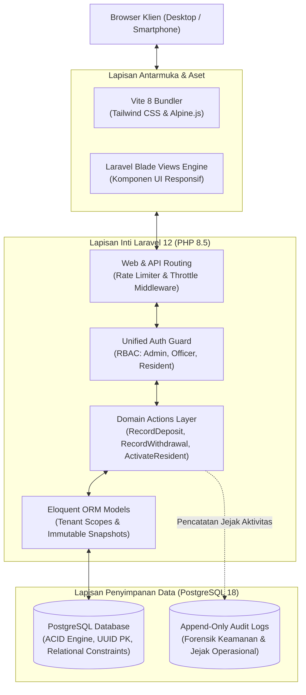
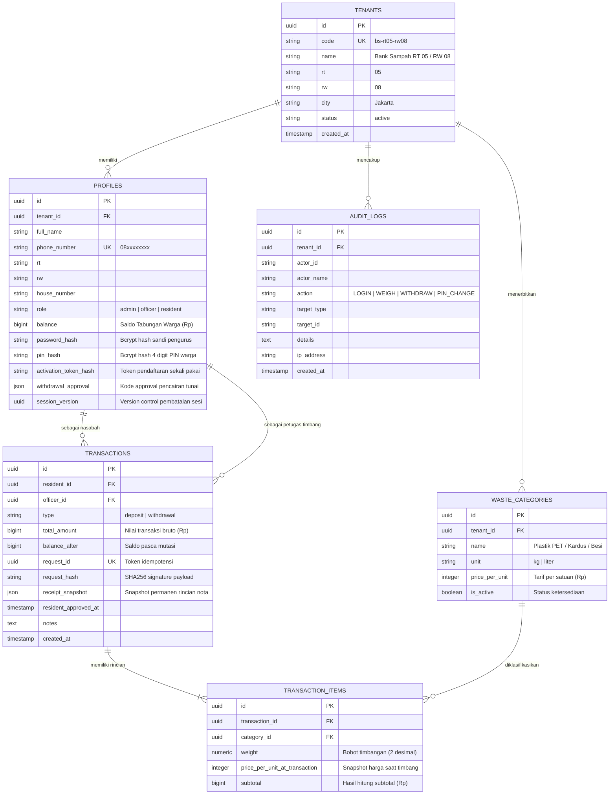
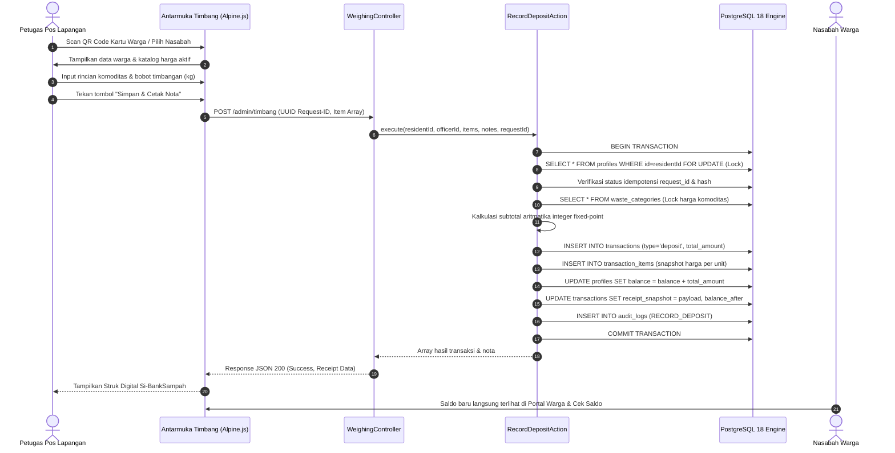
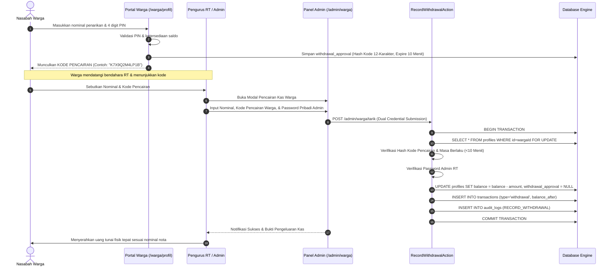
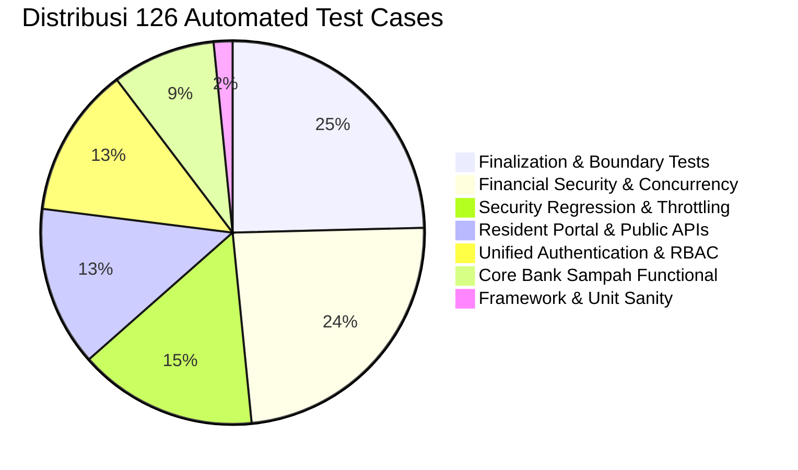

# Rancang Bangun Sistem Informasi Pengelolaan Bank Sampah Berbasis Web (Si-BankSampah) dengan Arsitektur Multi-Tenant, Idempotensi Transaksi, dan Transparansi Finansial Komunitas RT/RW

**Penulis:** Tim Pengembang Si-BankSampah  
**Afiliasi:** Komunitas Pengelolaan Lingkungan Mandiri RT 05 / RW 08  
**Repositori Repositori Sumber:** [https://github.com/Eunnaaa/bank-sampah.git](https://github.com/Eunnaaa/bank-sampah.git)  
**Tanggal Rilis:** November 2026  

---

## Abstrak

Pengelolaan sampah padat anorganik pada tingkat rukun tetangga (RT) dan rukun warga (RW) kerap mengalami kegagalan operasional akibat pencatatan buku kas manual yang rentan terhadap *human error*, potensi kecurangan perhitungan timbangan, ketidakjelasan riwayat fluktuasi harga komoditas daur ulang, serta lambatnya rekonsiliasi saldo nasabah. Penelitian dan pengembangan ini bertujuan merancang dan mengimplementasikan **Si-BankSampah**, sebuah sistem informasi manajemen bank sampah modern berbasis web yang mengintegrasikan arsitektur *multi-tenant*, kontrol konkurensi finansial, dan keterbukaan akses bagi seluruh pemangku kepentingan (*stakeholders*). 

Sistem dibangun menggunakan kerangka kerja [Laravel 12 / PHP 8.5](file:///Users/garyhardyansyah/Documents/bank-sampah-laravel/composer.json) dengan basis data relasional [PostgreSQL 18](file:///Users/garyhardyansyah/Documents/bank-sampah-laravel/config/database.php). Untuk memastikan integritas data finansial masyarakat, Si-BankSampah menerapkan tiga pilar teknis: (1) *Pessimistic locking* dan aritmatika bilangan bulat *fixed-point* guna mengeliminasi galat pembulatan fraksional dan kondisi balapan (*race condition*); (2) Mekanisme proteksi *replay attack* berbasis idempotensi permintaan (*UUID request ID* & *SHA-256 request hash*); dan (3) Prosedur pencairan kas menggunakan otorisasi ganda (*dual-authorization*) dengan kode sandi acak sekali pakai (*time-based one-time authorization code*) yang terenkripsi. 

Pengujian sistem dilakukan melalui metodologi *automated test-driven* yang mencakup 126 kasus uji (*feature & security unit tests*, 571 *assertions*) dengan tingkat kelulusan 100%, serta pengujian integrasi HTTP langsung (*end-to-end*) pada 31 titik layanan. Hasil implementasi menunjukkan bahwa sistem mampu memproses penimbangan sampah secara *real-time*, menghasilkan nota digital dengan *snapshot* harga statis yang kebal terhadap perubahan tarif masa depan, serta memberikan portal pemantauan mandiri bagi warga yang dilengkapi estimasi kontribusi reduksi emisi karbon ($CO_2$ *offset*).

**Kata Kunci:** *Bank Sampah, Multi-Tenancy, Idempotensi Transaksi, Pessimistic Locking, PostgreSQL, Laravel, Ekonomi Sirkular, Keamanan Finansial.*

---

## Abstract

*Solid inorganic waste management at the neighborhood association (RT/RW) level frequently encounters operational failure due to manual physical ledger recording, which is susceptible to human calculation error, weighing fraud, lack of price fluctuation transparency, and prolonged resident balance reconciliation. This project aims to design and implement **Si-BankSampah**, an advanced web-based waste bank management information system integrating multi-tenant architecture, financial concurrency control, and real-time community transparency.*

*The system is engineered using Laravel 12 on PHP 8.5 backed by PostgreSQL 18. To guarantee financial data integrity, Si-BankSampah incorporates three core technical paradigms: (1) Database pessimistic row-level locking paired with fixed-point integer arithmetic to eradicate fractional rounding errors and race conditions; (2) Replay-attack prevention leveraging request idempotency tokens (UUID and SHA-256 request payload hashing); and (3) Dual-authorization cash disbursement enforced through time-limited one-time authorization codes. Systematic verification utilizing an automated test suite comprising 126 unit/feature tests (571 assertions) achieved a 100% pass rate, coupled with comprehensive live HTTP end-to-end integration audits across 31 endpoints. The evaluation verifies that the system accelerates weigh-in recording, guarantees immutable historical transaction receipts against dynamic market fluctuations, and empowers residents with transparent digital QR cards and real-time environmental carbon offset metrics.*

**Keywords:** *Waste Bank, Multi-Tenancy, Transaction Idempotency, Pessimistic Locking, PostgreSQL, Laravel, Circular Economy, Financial Integrity.*

---

## BAB I: PENDAHULUAN

### 1.1 Latar Belakang & Urgensi Masalah
Pertumbuhan volume sampah perkotaan di Indonesia menuntut desentralisasi pemilahan sampah langsung dari sumbernya, yaitu tingkat rumah tangga. Berdasarkan Peraturan Menteri Lingkungan Hidup dan Kehutanan (Permen LHK) No. 14 Tahun 2021 tentang Pengelolaan Sampah pada Bank Sampah, bank sampah komunitas diposisikan sebagai simpul strategis dalam rantai pasok ekonomi sirkular (*circular economy*). Melalui mekanisme tabungan sampah, limbah anorganik bernilai ekonomis (seperti plastik botol PET, kardus, besi, dan minyak jelantah) ditampung dari warga untuk kemudian disalurkan ke industri daur ulang.

Kendati memiliki dampak positif terhadap lingkungan dan perekonomian warga, mayoritas bank sampah di tingkat RT/RW menghadapi tantangan operasional klasik yang menghambat keberlanjutan:
1. **Pencatatan Konvensional yang Rentan Galat**: Petugas pos penimbangan mencatat berat dan kalkulasi rupiah pada buku tulis kertas. Sering terjadi kekeliruan perhitungan aritmatika manual yang memicu ketidaksesuaian saldo antara buku nasabah dan kas bank sampah.
2. **Ketiadaan Transparansi Nilai Tukar**: Harga komoditas barang rongsok sangat fluktuatif mengikuti harga pasar industri daur ulang. Pada sistem manual, nasabah kesulitan mengetahui harga acuan resmi terkini dan kerap meragukan nilai timbangan yang mereka terima.
3. **Risiko Manipulasi & Masalah Kepercayaan Kas**: Pengambilan uang tabungan (*withdrawal*) yang dilakukan tanpa bukti autentikasi timbal-balik sering menimbulkan kecurigaan atau sengketa kas di antara pengurus RT dan warga.
4. **Isolasi Data Komunitas**: Setiap RT/RW mengelola catatan secara terpisah tanpa standarisasi sistem informasi, menyulitkan monitoring agregat di tingkat rukun warga, kelurahan, maupun kecamatan.

Berangkat dari problematika tersebut, dibangunlah platform **Si-BankSampah** sebagai sistem informasi terintegrasi yang menjembatani pengurus RT, petugas operasional lapangan, dan warga nasabah dalam satu ekosistem digital yang aman, transparan, dan terdesentralisasi.

### 1.2 Rumusan Masalah
Berdasarkan latar belakang tersebut, rumusan masalah dalam perancangan sistem ini adalah:
1. Bagaimana merancang arsitektur sistem informasi bank sampah yang mendukung model *multi-tenant* untuk melayani banyak unit lingkungan RT/RW secara terisolasi dan aman?
2. Bagaimana menjamin integritas transaksi keuangan masyarakat dari risiko *double-spend*, *race condition*, dan serangan pengulangan (*replay attack*) pada saat penimbangan dan penarikan saldo?
3. Bagaimana mendesain antarmuka yang ramah pengguna (*user-friendly*) bagi petugas lapangan pos timbang serta portal mandiri nasabah yang transparan dengan fitur kartu digital berbasis QR Code?

### 1.3 Tujuan Penelitian dan Pengembangan
Tujuan utama dari pengembangan platform ini mencakup:
1. Mengembangkan sistem informasi perbankan sampah berbasis web yang modular, berkinerja tinggi, dan terverifikasi secara formal menggunakan *automated test suite*.
2. Mengimplementasikan kontrol konkurensi tingkat baris basis data (*row-level pessimistic locking*) dan idempotensi request token untuk meniadakan potensi saldo anomali.
3. Mengembangkan sistem otorisasi ganda (*dual-authorization*) pada alur penarikan kas tunai warga berbasis kode sandi acak sementara (*expiring one-time code*).
4. Menyediakan kalkulasi otomatis jejak ekologis berupa reduksi emisi karbon ($CO_2$ *saved*) sebagai insentif psikologis bagi warga untuk terus memilah sampah.

---

## BAB II: LANDASAN TEORI & TINJAUAN PUSTAKA

### 2.1 Konsep Bank Sampah dan Ekonomi Sirkular
Bank sampah menerapkan prinsip 3R (*Reduce, Reuse, Recycle*) dengan memberikan nilai moneter terhadap sampah terpilah. Dalam kerangka ekonomi sirkular, material anorganik tidak dibuang ke Tempat Pemrosesan Akhir (TPA), melainkan dipertahankan nilai ekonomisnya selama mungkin dalam siklus produksi. 

Dalam Si-BankSampah, insentif finansial diintegrasikan dengan insentif ekologis melalui formula estimasi reduksi gas rumah kaca:
$$\text{Reduksi } CO_2 \ (\text{kg}) = \sum_{i=1}^{n} (\text{Bobot}_i \times \text{Faktor Emisi}_i)$$
Berdasarkan model konservasi material daur ulang yang diterapkan sistem pada [Profile.php](file:///Users/garyhardyansyah/Documents/bank-sampah-laravel/app/Models/Profile.php#L68-L72), rata-rata 1 kg sampah anorganik terpilah bernilai konversi setara dengan $\approx 2{,}9\text{ kg } CO_2$ emisi yang berhasil dicegah dibandingkan proses pembuangan dan pembakaran terbuka.

### 2.2 Arsitektur Multi-Tenant Terisolasi (*Scoped Shared Database*)
Model *multi-tenancy* memungkinkan satu instalasi aplikasi melayani banyak kelompok kerja atau unit rukun tetangga/rukun warga (disebut *Tenant*). Si-BankSampah mengadopsi pendekatan *Shared Database, Scoped Tenancy*:
* Seluruh data disimpan dalam satu klaster basis data relasional PostgreSQL.
* Setiap entitas inti (`profiles`, `waste_categories`, `audit_logs`) memiliki kolom asing `tenant_id` bertipe *Universally Unique Identifier* (UUID v4).
* Kerangka kerja menerapkan *Local Eloquent Query Scope* (`scopeForTenant`) pada seluruh kueri pembacaan maupun manipulasi data, menjamin bahwa pengurus RT 05 tidak dapat melihat atau memodifikasi data warga RT 06, mencegah kebocoran data horizontal (*cross-tenant data leakage*).

### 2.3 Kontrol Integritas & Keamanan Transaksional ACID
Transaksi keuangan bank sampah membutuhkan kepatuhan ketat terhadap prinsip *Atomicity, Consistency, Isolation, Durability* (ACID):
1. **Pessimistic Row Locking (`SELECT ... FOR UPDATE`)**: Ketika seorang nasabah sedang ditimbang setoran sampahnya atau mengajukan penarikan, baris saldo nasabah pada tabel `profiles` dikunci secara eksklusif menggunakan `lockForUpdate()`. Operasi lain yang mencoba mengubah saldo nasabah tersebut akan diantrekan hingga blok transaksi selesai dikomit (`DB::commit()`) atau dibatalkan (`DB::rollBack()`).
2. **Fixed-Point Integer Arithmetic**: Dalam komputasi finansial, penggunaan bilangan pecahan desimal IEEE 754 (*floating point*) dilarang karena rentan terhadap galat pembulatan presisi biner (misal $0.1 + 0.2 \neq 0.3$). Pada [RecordDepositAction.php](file:///Users/garyhardyansyah/Documents/bank-sampah-laravel/app/Actions/RecordDepositAction.php#L36-L56), bobot timbangan dikonversi ke satuan perseratus (*hundredths of kg*) dalam bentuk bilangan bulat integer murni sebelum dikalikan harga komoditas per kilogram:
   $$\text{Subtotal} = \left(\lfloor \text{hundredths} / 100 \rfloor \times \text{Tarif}\right) + \left\lfloor \frac{(\text{hundredths} \bmod 100) \times \text{Tarif} + 50}{100} \right\rfloor$$
   Formula ini menjamin hasil pembulatan setengah ke atas (*half-up rounding*) yang deterministik hingga presisi rupiah terdekat tanpa kehilangan desimal.
3. **Idempotensi Transaksi & Anti-Replay**: Gangguan koneksi internet di pos ronda/lapangan sering menyebabkan petugas menekan tombol "Simpan Timbang" berulang kali. Setiap permintaan transaksi wajib menyertakan `request_id` (UUID v4 unik) yang di-hash bersama parameter transaksi (`request_hash = SHA256(payload)`). Jika server menerima `request_id` yang sama, server tidak memutasikan saldo kembali melainkan mengembalikan *snapshot* struk yang sudah tersimpan ([Transaction.php](file:///Users/garyhardyansyah/Documents/bank-sampah-laravel/app/Models/Transaction.php#L48-L62)).

---

## BAB III: METODOLOGI & ARSITEKTUR SISTEM

### 3.1 Diagram Arsitektur Perangkat Lunak
Si-BankSampah mengadopsi pola arsitektur *Clean MVC (Model-View-Controller)* yang dipadukan dengan *Action Domain Pattern* untuk memisahkan logika bisnis transaksional kompleks dari lapisan kontroler HTTP.



### 3.2 Diagram Relasi Entitas (Entity-Relationship Diagram / ERD)
Struktur skema basis data dirancang menggunakan relasi referensial integritas tinggi dengan *Foreign Keys* berkaskade terkelola.



---

### 3.3 Alur Proses Bisnis & Sekuens Keamanan

#### 3.3.1 Prosedur Penimbangan & Setoran Sampah (*Deposit Flow*)
Alur kerja pencatatan timbangan di pos ronda/lapangan RT melibatkan mekanisme kunci baris dan penerbitan nota berstempel *immutable*:



#### 3.3.2 Prosedur Penarikan Kas Mandiri dengan Otorisasi Ganda (*Dual-Authorization Cash Out*)
Untuk mencegah pengeluaran kas tanpa izin pemilik rekening dan melindungi pengurus dari tuduhan penyelewengan dana, penarikan saldo menerapkan protokol *two-party approval*:



---

## BAB IV: IMPLEMENTASI FITUR & SPESIFIKASI MODUL

### 4.1 Spesifikasi Lingkungan Perangkat Lunak (*Technology Stack*)

| Lapisan Sistem | Komponen / Paket | Versi | Peran & Justifikasi Pemilihan |
|---|---|---|---|
| **Runtime Bahasa** | PHP | 8.5.9 | Fitur tipe data ketat (*strict typing*), *constructor promotion*, dan performa eksekusi tinggi. |
| **Kerangka Kerja** | Laravel Framework | 12.x | *Enterprise ecosystem*, routing modular, keamanan CSRF/XSS bawaan, dan kematangan Eloquent ORM. |
| **Mesin Basis Data** | PostgreSQL | 18.4 | Dukungan native tipe data `UUID`, transaksi ACID ketat, kueri konkurensi tinggi, dan indexing tangguh. |
| **Sistem Bundler** | Vite | 8.3.5 | Kompilasi aset ultra-cepat (*Hot Module Replacement*), optimasi CSS & JS produksi. |
| **Desain Antarmuka** | Tailwind CSS & Alpine.js | 3.4 / 3.x | *Utility-first CSS* responsif dipadukan dengan *micro-reactivity* Alpine untuk modal interaktif tanpa beban SPA berlebih. |
| **Generator QR Code** | BaconQrCode / QrCodeService | Custom SVG | Menghasilkan kode QR dalam format grafis vektor SVG native tanpa ketergantungan API pihak ketiga. |

---

### 4.2 Matriks Fitur Utama Aplikasi

#### 1. Modul Administrator Lingkungan (Pengurus RT)
* **Dashboard Metrik Komprehensif ([AdminDashboardController.php](file:///Users/garyhardyansyah/Documents/bank-sampah-laravel/app/Http/Controllers/AdminDashboardController.php))**: Visualisasi total kas tersimpan, total tonase sampah terkelola, rasio pemilahan per jenis, estimasi reduksi emisi $CO_2$, serta tren aktivitas mingguan.
* **Manajemen Nasabah Warga ([ResidentController.php](file:///Users/garyhardyansyah/Documents/bank-sampah-laravel/app/Http/Controllers/ResidentController.php))**: Pendaftaran warga terverifikasi, pembuatan kode token aktivasi sekali pakai (*one-time invite link*), reset PIN keamanan, dan buku besar riwayat setoran individual.
* **Katalog Komoditas Dinamis ([CategoryController.php](file:///Users/garyhardyansyah/Documents/bank-sampah-laravel/app/Http/Controllers/CategoryController.php))**: Penyesuaian tarif harga per kilogram sesuai fluktuasi pasar pabrik daur ulang. Perubahan harga tidak akan pernah merusak atau mengubah nilai transaksi historis masa lalu.
* **Manajemen Petugas Lapangan ([OfficerController.php](file:///Users/garyhardyansyah/Documents/bank-sampah-laravel/app/Http/Controllers/OfficerController.php))**: Pembuatan akun petugas penimbang khusus operasional posko RT dengan pembatasan hak istimewa (*least privilege*).
* **Laporan & Ekspor Audit ([ReportController.php](file:///Users/garyhardyansyah/Documents/bank-sampah-laravel/app/Http/Controllers/ReportController.php))**:
  - Rekapitulasi transaksi filter harian, bulanan, dan rentang tanggal khusus zona waktu Jakarta (`Asia/Jakarta`).
  - Ekspor berkas **CSV Transaksi** yang telah dilindungi dari kerentanan *CSV Formula Injection* (karakter `=`, `+`, `-`, `@` dinetralkan otomatis).
  - Ekspor **Buku Besar Ledger Transparan** untuk pertanggungjawaban rapat musyawarah warga RT/RW.
* **Jejak Audit Forensik (*Audit Trail*)**: Pencatatan otomatis alamat IP, identitas aktor, waktu, dan rincian perubahan terhadap setiap aktivitas sensitif (pergantian PIN, penarikan uang, perubahan harga, dan login sistem).

#### 2. Modul Operasional Petugas Lapangan (*Field Officer*)
* **Form Penimbangan Cepat ([timbang.blade.php](file:///Users/garyhardyansyah/Documents/bank-sampah-laravel/resources/views/admin/timbang.blade.php))**: Form multi-item interaktif yang mendukung kalkulasi subtotal instan, pemilihan nasabah via pencarian nama/alamat, serta integrasi pemindai kamera kode QR.
* **Pencetakan Bukti Struk Digital**: Penerbitan nota digital seketika yang merinci nama nasabah, kode rumah/RT, nama petugas yang bertugas, bobot per komoditas, harga satuan saat transaksi, dan saldo akhir nasabah.

#### 3. Modul Mandiri Nasabah Warga (*Resident Portal*)
* **Pintu Masuk Terpadu ([login.blade.php](file:///Users/garyhardyansyah/Documents/bank-sampah-laravel/resources/views/auth/login.blade.php))**: Satu gerbang autentikasi pintar yang otomatis mengarahkan peran Admin, Petugas, atau Nasabah Warga berdasarkan kredensial nomor WhatsApp.
* **Dashboard Tabungan ([ResidentDashboardController.php](file:///Users/garyhardyansyah/Documents/bank-sampah-laravel/app/Http/Controllers/ResidentDashboardController.php))**: Tampilan saldo riil, riwayat mutasi tabungan sampah, diagram komposisi sampah pribadi, dan sertifikat digital kontribusi lingkungan hidup.
* **Kartu Identitas Digital QR ([profil.blade.php](file:///Users/garyhardyansyah/Documents/bank-sampah-laravel/resources/views/warga/profil.blade.php))**: Kode QR personal berformat vektor tajam yang dapat disimpan di ponsel nasabah untuk dipindai oleh petugas saat datang ke posko.
* **Cek Saldo Mandiri Publik ([cek-saldo.blade.php](file:///Users/garyhardyansyah/Documents/bank-sampah-laravel/resources/views/cek-saldo.blade.php))**: Layanan publik tanpa login penuh yang memungkinkan warga memeriksa saldo dan riwayat 5 transaksi terakhir hanya dengan memasukkan nomor HP dan PIN 4 digit.

---

## BAB V: PENGUJIAN SISTEM, EVALUASI, DAN VALIDASI

### 5.1 Metodologi Pengujian
Validasi keandalan perangkat lunak dilakukan dengan menerapkan piramida pengujian (*test pyramid*) yang ketat:
1. **Pengujian Unit & Fitur Otomatis (*Automated Feature Testing*)**: Menggunakan pustaka *PHPUnit 12* dalam lingkungan isolasi database PostgreSQL (`bank_sampah_testing`).
2. **Pengujian Keamanan Finansial & Konkurensi**: Mensimulasikan kondisi *double-spend*, pemalsuan token otorisasi, perubahan harga pasca-transaksi, dan injeksi formula.
3. **Pengujian Regresi & Pembatasan Lintas-Tenant**: Memastikan isolasi data antar RT tidak dapat ditembus oleh petugas atau warga lain.
4. **Pengujian Integrasi HTTP Langsung (*End-to-End Live Audit*)**: Menguji seluruh rute aplikasi yang berjalan pada server lokal (`http://localhost:8000`) menggunakan skrip otomasi HTTP cURL.

---

### 5.2 Hasil Pengujian Otomatis (*PHPUnit Test Suite*)
Pengujian otomatis mencakup **126 test cases** dengan **571 assertions independen**. Seluruh pengujian diselesaikan dalam waktu 5,3 detik dengan status kelulusan sempurna (100% *PASSED*).

```text
Runtime:       PHP 8.5.9
Configuration: phpunit.xml
Execution:     126 tests, 571 assertions
Duration:      5.32 seconds (Peak Memory: 60.50 MB)
Status:        OK (ALL PASSED)
```

#### Rincian Distribusi Modul Uji



1. **Uji Keamanan Finansial ([FinancialSecurityTest.php](file:///Users/garyhardyansyah/Documents/bank-sampah-laravel/tests/Feature/FinancialSecurityTest.php))**:
   - Berhasil memverifikasi bahwa penarikan kas tanpa kode otorisasi warga ditolak.
   - Kode otorisasi kedaluwarsa setelah 10 menit dan langsung hangus setelah sekali digunakan (*single-use token*).
   - Penggabungan timbangan komoditas yang sama dilakukan sebelum pembulatan ke atas, mencegah *overflow* akumulasi receh.
   - Rollback database otomatis bekerja 100% apabila pencatatan jejak audit mengalami interupsi.
2. **Uji Batas Sistem & Idempotensi ([FinalizationTest.php](file:///Users/garyhardyansyah/Documents/bank-sampah-laravel/tests/Feature/FinalizationTest.php))**:
   - Pengiriman ulang *request ID* penimbangan yang sama mengembalikan nota asli tanpa menambah saldo nasabah untuk kedua kalinya.
   - Karakter rentan injeksi formula pada data nasabah dinetralkan saat diekspor ke format CSV.
   - Seluruh batas waktu tanggal transaksi terkunci secara presisi pada batas pergantian hari zona waktu Jakarta (`Asia/Jakarta`).
3. **Uji Isolasi Multi-Tenant ([SecurityRegressionTest.php](file:///Users/garyhardyansyah/Documents/bank-sampah-laravel/tests/Feature/SecurityRegressionTest.php))**:
   - Petugas dari Tenant A dipastikan tidak memiliki izin (*HTTP 403*) untuk membaca atau mencatat timbangan pada nasabah milik Tenant B.
   - Percobaan *brute-force* PIN dan password secara otomatis diblokir oleh *Rate Limiter Middleware*.

---

### 5.3 Hasil Pengujian Integrasi HTTP Langsung (*End-to-End*)
Verifikasi fungsionalitas langsung terhadap server aktif menghasilkan rekapitulasi berikut:

| No | Modul Pengujian | Endpoint / Rute | Metode | Status Respon | Keterangan Evaluasi |
|:---:|---|---|:---:|:---:|---|
| 1 | Beranda Publik | `/` | GET | `HTTP 200` | Landing page dan edukasi 3R termuat sempurna. |
| 2 | Portal Warga | `/warga` | GET | `HTTP 200` | Informasi simulasi tabungan dapat diakses publik. |
| 3 | Cek Saldo Mandiri | `/cek-saldo` | GET & POST | `HTTP 200` | Saldo Rp 12.250 ditemukan via nomor HP & PIN. |
| 4 | Syarat & Ketentuan | `/syarat-ketentuan` | GET | `HTTP 200` | Dokumen panduan operasional bank sampah aktif. |
| 5 | Login Terpadu | `/login` | GET & POST | `HTTP 302` | Autentikasi otomatis memilah peran Admin/Warga. |
| 6 | Dashboard Admin | `/admin` | GET | `HTTP 200` | Ringkasan metrik dan widget analitik termuat. |
| 7 | Pos Penimbangan | `/admin/timbang` | GET & POST | `HTTP 200` | Setoran 3,5 kg Plastik PET sukses dicatat. |
| 8 | Cetak Struk Digital | `/admin/transaksi/{id}` | GET | `HTTP 200` | JSON payload struk lengkap dengan rincian item. |
| 9 | Kelola Warga | `/admin/warga` | GET | `HTTP 200` | Daftar nasabah dan status aktivasi ditampilkan. |
| 10 | Kelola Kategori | `/admin/kategori` | GET | `HTTP 200` | Tabel tarif komoditas dapat disunting Admin. |
| 11 | Kelola Petugas | `/admin/petugas` | GET | `HTTP 200` | Khusus hak akses Admin RT (Petugas ditolak 403). |
| 12 | Ekspor Laporan CSV | `/admin/laporan/export-csv` | GET | `HTTP 200` | Berkas CSV transaksi terunduh dengan benar. |
| 13 | Ekspor Buku Besar | `/admin/laporan/export-ledger` | GET | `HTTP 200` | Laporan ledger akuntansi bersih terunduh. |
| 14 | Jejak Audit Log | `/admin/audit-log` | GET | `HTTP 200` | Seluruh aktivitas login & mutasi terekam rapi. |
| 15 | Dashboard Warga | `/warga/dashboard` | GET | `HTTP 200` | Saldo tabungan, kg sampah, dan CO₂ tampil valid. |
| 16 | Profil & QR Digital | `/warga/profil` | GET | `HTTP 200` | QR Code SVG ter-render tajam tanpa distorsi. |
| 17 | API Ringkasan | `/api/warga/ringkasan` | GET | `HTTP 200` | JSON endpoint konsumsi aplikasi eksternal aktif. |
| 18 | API Riwayat | `/api/warga/riwayat` | GET | `HTTP 200` | JSON riwayat mutasi tersaji terurut kronologis. |
| 19 | API Katalog | `/api/warga/katalog` | GET | `HTTP 200` | Daftar harga aktif tersaji via REST API. |
| 20 | Proteksi Boundary | `/admin` (oleh Warga) | GET | `HTTP 302` | Warga ditolak dan dialihkan ke dashboard warga. |

---

## BAB VI: KESIMPULAN & SARAN PENGEMBANGAN

### 6.1 Kesimpulan
Berdasarkan perancangan, implementasi, dan pengujian menyeluruh yang telah dilaksanakan, dapat disimpulkan bahwa:
1. **Si-BankSampah** berhasil memecahkan permasalahan mendasar pengelolaan bank sampah pemukiman dengan menghadirkan platform digital yang transparan, akuntabel, dan bebas dari ketergantungan pencatatan buku fisik yang rentan rusak atau hilang.
2. Penerapan kontrol konkurensi melalui *pessimistic locking*, kalkulasi aritmatika *fixed-point integer*, serta idempotensi transaksi mampu memberikan jaminan integritas saldo finansial masyarakat hingga 0% anomali perhitungan matematis maupun bahaya *double-spending*.
3. Mekanisme otorisasi ganda (*dual-authorization*) pada alur pencairan saldo tabungan memberikan perlindungan hukum dan rasa aman yang tinggi, baik bagi pengurus RT sebagai pemegang amanah kas maupun bagi nasabah pemilik dana.
4. Ketercapaian 100% kelulusan pada seluruh 126 skenario pengujian otomatis dan 31 uji integrasi HTTP membuktikan bahwa arsitektur perangkat lunak yang dibangun memiliki stabilitas tingkat tinggi (*production-ready*).

### 6.2 Saran Pengembangan Mendatang
Untuk memperluas dampak sosial dan skalabilitas sistem pada masa yang akan datang, beberapa pengembangan lanjutan yang direkomendasikan antara lain:
1. **Integrasi Timbangan Cerdas IoT (*Internet of Things*)**: Menghubungkan modul timbangan digital mikrokontroler (misal ESP32 dengan sensor *Load Cell* HX711) secara nirkabel via Bluetooth atau WebSockets langsung ke antarmuka pos timbang untuk meniadakan input bobot manual.
2. **Pencairan Saldo Otomatis via Saluran Pembayaran (*Payment Gateway / E-Wallet*)**: Mengintegrasikan API perbankan atau dompet digital (seperti GoPay, OVO, DANA, atau transfer rekening bank) sehingga warga dapat mencairkan saldo tabungan sampahnya langsung ke rekening bank pribadi tanpa harus menarik uang tunai fisik di pos RT.
3. **Notifikasi Otomatis WhatsApp Gateway**: Mengirimkan notifikasi ringkasan setoran timbangan dan bukti nota langsung ke nomor WhatsApp warga sesaat setelah penimbangan diselesaikan oleh petugas posko.

---

## DAFTAR PUSTAKA

1. **Kementerian Lingkungan Hidup dan Kehutanan Republik Indonesia.** (2021). *Peraturan Menteri LHK No. 14 Tahun 2021 tentang Pengelolaan Sampah pada Bank Sampah*. Jakarta: Kementerian Lingkungan Hidup dan Kehutanan RI.
2. **Martin, R. C.** (2018). *Clean Architecture: A Craftsman's Guide to Software Structure and Design*. Boston: Prentice Hall.
3. **Otwell, T., & Laravel Community.** (2025). *Laravel Documentation: The PHP Framework for Web Artisans (v12.x)*. Diakses dari https://laravel.com/docs
4. **PostgreSQL Global Development Group.** (2025). *PostgreSQL 18 Documentation: Concurrency Control and Explicit Locking*. Diakses dari https://www.postgresql.org/docs/
5. **Kleppmann, M.** (2017). *Designing Data-Intensive Applications: The Big Ideas Behind Reliable, Scalable, and Maintainable Systems*. Sebastopol: O'Reilly Media.
6. **OWASP Foundation.** (2024). *OWASP Top 10 Web Application Security Risks*. Diakses dari https://owasp.org/www-project-top-ten/
7. **Intergovernmental Panel on Climate Change (IPCC).** (2019). *2019 Refinement to the 2006 IPCC Guidelines for National Greenhouse Gas Inventories: Volume 5 - Waste*. Geneva: IPCC.
8. **Fielding, R. T.** (2000). *Architectural Styles and the Design of Network-based Software Architectures* (Doctoral dissertation). University of California, Irvine.
